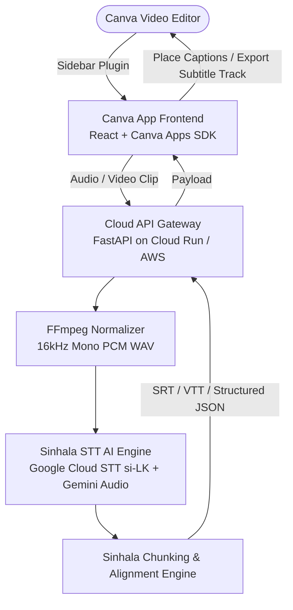

# Canva Sinhala Caption Plugin & Cloud STT (සිංහල උපසිරැසි AI)

An automated, high-accuracy Sinhala Speech-to-Text captioning plugin for Canva video editing, powered by a Cloud AI backend (Google Cloud Speech-to-Text `si-LK` & Gemini Audio).

---

## 🚀 Architecture Overview



---

## 📁 Repository Structure

```text
.
├── .github/
│   └── workflows/ci.yml         # Automated GitHub Actions test pipeline
├── canva-app/                   # Canva App Frontend (React + Vite + TypeScript)
│   ├── src/
│   │   ├── components/          # Reusable UI Controls
│   │   ├── services/
│   │   │   ├── api.ts           # Client for Cloud Backend
│   │   │   └── canvaSdk.ts      # Canva Apps SDK Integration
│   │   ├── types/index.ts       # Subtitle and Style interfaces
│   │   ├── App.tsx              # Main UI & Interactive Subtitle Editor
│   │   ├── index.css            # Dark mode design & typography
│   │   └── main.tsx
│   ├── package.json
│   ├── vite.config.ts
│   └── Dockerfile
├── cloud-backend/               # Cloud Speech-to-Text Microservice (FastAPI)
│   ├── app/
│   │   ├── services/
│   │   │   ├── audio_processor.py    # FFmpeg audio conversion
│   │   │   ├── sinhala_stt.py        # Google Cloud STT si-LK + Gemini Audio
│   │   │   └── caption_formatter.py  # Sinhala text chunking & SRT/VTT
│   │   ├── config.py
│   │   └── main.py
│   ├── requirements.txt
│   ├── .env.example
│   └── Dockerfile
├── docker-compose.yml           # Local full-stack container environment
└── README.md
```

---

## ⚡ Quick Start (Local Development)

### 1. Cloud Backend Setup
```bash
cd cloud-backend
python -m venv venv

# Windows:
.\venv\Scripts\activate
# Linux/macOS:
source venv/bin/activate

pip install -r requirements.txt
cp .env.example .env
# Edit .env and supply your GOOGLE_APPLICATION_CREDENTIALS or GEMINI_API_KEY
uvicorn app.main:app --host 0.0.0.0 --port 8080 --reload
```

### 2. Canva App Setup
```bash
cd canva-app
npm install
npm run dev
```
Open `http://localhost:3000` to test the UI and sample caption generation.

---

## 🎨 Connecting to Canva Developer Portal

1. Log in to [Canva Developers](https://www.canva.com/developers/).
2. Click **Create an app** and give it a name: `Sinhala Video Captions`.
3. Set **Development URL** to `http://localhost:3000` (or your deployed cloud HTTPS URL).
4. Request Permissions:
   - `canva:design:content:write`
   - `canva:asset:read`
5. Click **Preview in Canva** to open a live video editor session with your Sinhala Caption plugin!

---

## ☁️ Cloud Deployment

Both components are containerized for zero-friction cloud deployment (Google Cloud Run, AWS App Runner, or Render):

```bash
docker compose up --build
```
